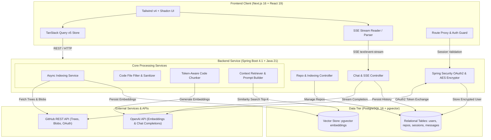

# DevPilot: Comprehensive Technical Documentation & Architecture Specification

---

## 1. Executive Summary & Overview

**DevPilot** is a full-stack, AI-powered developer platform that enables software engineers to chat interactively with any GitHub repository using **Retrieval-Augmented Generation (RAG)**. 

By integrating GitHub OAuth2, asynchronous repository tree parsing, smart code chunking, vector embeddings with **Spring AI** and **PostgreSQL (pgvector)**, and **real-time Server-Sent Events (SSE)** token streaming, DevPilot allows developers to ask architectural, semantic, and debugging questions about large codebases and receive grounded, hallucination-resistant answers with line-level GitHub source citations.

---

## 2. Problem Statement & Solution

### 2.1 The Problem
Modern software development involves navigating large, unfamiliar, or legacy codebases. Developers encounter distinct hurdles:
- **Steep Onboarding Curves**: New engineers spend weeks reading through complex directory structures, undocumented modules, and unfamiliar idioms to understand how systems operate.
- **Context Switching**: Asking general-purpose LLMs (e.g., ChatGPT) requires manually copying and pasting fragments of code, which is cumbersome, loses critical cross-file context, and risks leaking sensitive proprietary code if done improperly.
- **Hallucinations & Stale Knowledge**: General AI assistants cannot read your private or proprietary GitHub repositories and frequently hallucinate functions, APIs, or architectural patterns that do not exist in your project.
- **Lack of Verifiable Grounding**: Developers need to verify AI suggestions against real code. Generic answers lack exact file paths and line number references.

### 2.2 The Solution
DevPilot solves these issues through an end-to-end automated pipeline:
1. **One-Click GitHub Authentication**: Connect GitHub accounts via OAuth2 with granular repository read access.
2. **Automated Code Indexing**: Intelligently scans repository trees, filters out binaries and lockfiles, chunks code using token-aware splitters, and embeds chunks using OpenAI embeddings into `pgvector`.
3. **Retrieval-Augmented Generation (RAG)**: When a question is asked, DevPilot searches the repository's vector space for the most semantically relevant code chunks (Top-K) and constructs grounded prompts.
4. **Streaming Dialogue with Source Citations**: Responses are streamed token-by-token using SSE and formatted with rich Markdown and interactive citation badges that deep-link directly to the specific lines in the GitHub source repository.
5. **Secure At-Rest Token Storage**: All GitHub OAuth personal access tokens are symmetrically encrypted at rest using AES via Spring Security's `TextEncryptor`.

---

## 3. System Architecture & High-Level Design

### 3.1 Architecture Diagram



### 3.2 Data Flow & Processing Lifecycle

1. **Authentication Flow**:
   - The user visits the frontend and clicks **Continue with GitHub**.
   - The frontend triggers `/oauth2/authorization/github` on the Spring Boot backend.
   - Spring Security handles the OAuth2 handshake with GitHub, obtaining a scoped access token (`read:user,repo`).
   - `GithubOAuth2UserService` intercepts the user attributes, encrypts the access token via `TextEncryptor` (AES), upserts the `User` entity, and creates an HTTP-only secure session cookie (`DEVPILOT_SESSION`).
   - The user is redirected back to `/auth/callback` and onto `/dashboard`.

2. **Repository Synchronization & Indexing Flow**:
   - The dashboard calls `GET /api/repos?refresh=true`.
   - The backend queries the GitHub API (`/user/repos`) using the decrypted user access token, syncing repository metadata into the `repositories` table.
   - The user clicks **Index Repository** on a selected repository card (`POST /api/repos/{id}/index`).
   - The backend transitions the repo status to `INDEXING` and offloads indexing to `ThreadPoolTaskExecutor` (`@Async("indexingExecutor")`).
   - The indexing service:
     1. Clears existing vectors for that `repositoryId` to ensure a clean state.
     2. Fetches the recursive Git tree (`/repos/{owner}/{repo}/git/trees/{branch}?recursive=1`).
     3. Filters out excluded directories (`node_modules`, `.git`, `build`, etc.), lockfiles, and binaries.
     4. Iteratively fetches file contents with rate-limiting pauses (`GitHubRateLimiter`).
     5. Chunks file text with `TokenTextSplitter` (~200 tokens per chunk) and tags each chunk with metadata (`repoId`, `filePath`, `language`, `chunkIndex`).
     6. Emits chunks in batches of 32 to `VectorStore` (which sends them to OpenAI's embedding model and stores them in PostgreSQL's `vector` column).
     7. Periodically updates database progress counters (`filesProcessed`, `filesTotal`, `chunkCount`).
     8. Marks the repository as `READY`.

3. **RAG-Powered Chat & SSE Streaming Flow**:
   - The user creates or enters a chat session (`POST /api/chat/sessions`) and submits a prompt.
   - The frontend establishes an SSE connection via `POST /api/chat/sessions/{id}/messages`.
   - The backend saves the user message in `chat_messages`.
   - `CodeContextRetriever` issues a similarity search on `VectorStore`, filtering by `repoId == {repositoryId}` with `topK = 8`.
   - `ChatPromptBuilder` constructs:
     - **System Prompt**: Enforces strict grounding in the provided code context and instructs the model to cite exact files and line ranges.
     - **User Prompt**: Injects retrieved code blocks followed by the user question.
   - `ChatStreamHandler` calls OpenAI via Spring AI `ChatClient.stream()`.
   - As tokens arrive from OpenAI, they are sent as SSE `token` events to the client.
   - When the model finishes, citations and the full assistant reply are persisted to `chat_messages`, and an `assistant_message` event followed by `done` is emitted.
   - The frontend renders markdown, syntax-highlighted code blocks, and clickable citation chips pointing to the GitHub source files.

---

## 4. Technology Stack Deep-Dive

### 4.1 Backend Architecture

| Technology | Version | Purpose / Architectural Role |
| :--- | :--- | :--- |
| **Java** | 21 (LTS) | Core programming language leveraging modern switch expressions, records, pattern matching, and virtual thread readiness. |
| **Spring Boot** | 4.1.0 | Enterprise application framework providing dependency injection, actuator metrics, and embedded web server. |
| **Spring AI** | 2.0.0 | AI abstraction layer managing OpenAI chat models, embedding generations, and vector store operations. |
| **Spring AI PgVector Starter** | 2.0.0 | Vector database integration using PostgreSQL with vector cosine distance search. |
| **Spring Security & OAuth2 Client** | 4.1.0 | Manages OAuth2 authorization code grant flow with GitHub, secure cookie session policies, and endpoint security. |
| **Spring Data JPA & Hibernate** | 4.1.0 | Object-relational mapping (ORM) for managing PostgreSQL entities and transactions. |
| **Spring WebMVC** | 4.1.0 | REST controller layer, exception handling, and Server-Sent Events (`SseEmitter`). |
| **Jackson JSON** | 3.x | High-performance JSON serialization/deserialization for citation mappings and API payloads. |
| **Lombok** | Latest | Reduces boilerplate for getters, setters, builders, and logging (`@Slf4j`). |

### 4.2 Frontend Architecture

| Technology | Version | Purpose / Architectural Role |
| :--- | :--- | :--- |
| **Next.js** | 16.2.12 | Modern React framework with App Router, server/client components, and middleware route proxying. |
| **React** | 19.2.4 | UI rendering engine supporting modern hooks, streaming, and transitions. |
| **TypeScript** | 5.x | Static typing for type safety across all DTOs, API clients, and component props. |
| **Tailwind CSS** | v4 | Modern styling engine with native CSS cascade layers, custom OKLCH color palettes, and container queries. |
| **TanStack React Query** | 5.101.4 | Client-side server state cache, background query refetching, optimistic updates, and cache invalidation. |
| **Streamdown & Code Highlighting** | 2.5.0 | High-performance streaming Markdown renderer supporting real-time code highlighting during LLM generation. |
| **Lucide React** | 1.27.0 | Clean, accessible SVG iconography. |
| **Next-Themes** | 0.4.6 | Seamless dark/light theme switching with zero flash-of-unstyled-content (FOUC). |

### 4.3 Database & Vector Infrastructure

| Technology | Purpose |
| :--- | :--- |
| **PostgreSQL 16** | Robust relational persistence for users, repositories, sessions, and chat messages. |
| **pgvector** | High-performance vector similarity search extension enabling native vector indexing (HNSW / IVFFlat) and Cosine similarity queries directly in SQL. |
| **uuid-ossp & hstore** | Native UUID primary key generation and key-value store support. |
| **Docker Compose** | Containerized database setup configured for reproducible local and staging environments. |

---

## 5. Module & Component Breakdown

### 5.1 Backend Component Structure

```
backend/src/main/java/devPilot/backend/
├── BackendApplication.java              # Application bootstrap entry point
├── config/
│   ├── AppConfig.java                   # RestClient builder & Async ThreadPool executor
│   ├── CorsConfig.java                  # CORS origin policies & allowed headers
│   ├── CryptoConfig.java                # AES TextEncryptor bean configuration
│   └── SecurityConfig.java              # Security filter chain, OAuth2 handlers, cookies
├── controllers/
│   ├── AuthController.java              # Login URL provider and /api/auth/me user endpoint
│   ├── RepoController.java              # Repo sync, listing, indexing triggers & status polling
│   └── ChatController.java              # Chat session management and SSE message streaming
├── dto/                                 # Strongly typed records for API requests and responses
│   ├── ChatMessageRequest.java
│   ├── ChatMessageResponse.java
│   ├── ChatSessionResponse.java
│   ├── CitationDto.java
│   ├── CreateChatSessionRequest.java
│   ├── IndexStatusResponse.java
│   ├── RepositoryResponse.java
│   └── UserResponse.java
├── entity/                              # JPA database entities
│   ├── User.java                        # Users with encrypted GitHub access tokens
│   ├── Repository.java                  # Synchronized GitHub repository metadata & indexing stats
│   ├── ChatSession.java                 # Conversational session grouping
│   ├── ChatMessage.java                 # Individual user and assistant messages with citation JSON
│   ├── IndexStatus.java                 # Status enum (PENDING, INDEXING, READY, FAILED)
│   └── MessageRole.java                 # Role enum (USER, ASSISTANT)
├── exceptions/                          # Custom exceptions & GlobalExceptionHandler
├── repository/                          # Spring Data JPA repositories
├── security/                            # OAuth2 user services and authenticated principal wrappers
└── services/
    ├── UserService.java                 # User creation, token encryption & decryption
    ├── RepoService.java                 # GitHub repo synchronization and database persistence
    ├── ChatService.java                 # Chat session orchestration and RAG pipeline execution
    ├── ai/
    │   ├── RagSettings.java             # Constants for Top-K chunks (8) and SSE timeouts
    │   ├── CodeContextRetriever.java    # VectorStore similarity search filtered by repoId
    │   ├── ChatPromptBuilder.java       # System and user prompt construction with grounding rules
    │   ├── ChatStreamHandler.java       # Spring AI ChatClient streaming via SseEmitter
    │   └── CitationMapper.java          # Document metadata to CitationDto converter
    ├── github/
    │   ├── GithubApiClient.java         # RestClient wrapper for trees, blobs, and repos
    │   └── GitHubRateLimiter.java       # Configurable delay mechanism to respect API rate limits
    └── indexing/
        ├── CodeFileFilter.java          # File eligibility validator (extensions, blacklist dirs)
        ├── CodeChunker.java             # TokenTextSplitter wrapper attaching file metadata
        └── IndexingService.java         # Orchestrates async indexing, chunking, and vector storage
```

### 5.2 Frontend Component Structure

```
client/
├── app/
│   ├── auth/callback/page.tsx           # OAuth callback handler verifying session state
│   ├── chat/[repoId]/page.tsx           # Dynamic chat workspace route
│   ├── dashboard/
│   │   ├── page.tsx                     # Main repository catalog view
│   │   ├── overview/page.tsx            # Analytics, status counters, and recent repos
│   │   └── settings/page.tsx            # User profile, theme settings, and session control
│   ├── login/page.tsx                   # Clean authentication portal
│   ├── globals.css                      # Tailwind v4 theme variables and design tokens
│   └── layout.tsx                       # Root layout with QueryProvider and ThemeProvider
├── components/
│   ├── chat/
│   │   ├── chat-view.tsx                # Master chat layout orchestrating sidebar, messages, composer
│   │   ├── chat-sidebar.tsx             # Session switcher and indexing progress monitor
│   │   ├── chat-messages.tsx            # Message stream scroller with role-based formatting
│   │   ├── chat-composer.tsx            # Auto-resizing textarea with keyboard submission
│   │   ├── chat-markdown.tsx            # Markdown rendering with syntax-highlighted code blocks
│   │   ├── citation-chips.tsx           # Clickable badge links to GitHub lines of code
│   │   └── indexing-state.tsx           # Visual progress bar during ongoing repository indexing
│   ├── dashboard/
│   │   ├── dashboard-header.tsx         # Search, status filters, and GitHub sync button
│   │   ├── repo-card.tsx                # Repository card with metadata, badges, and action triggers
│   │   ├── overview-dashboard.tsx       # Stat cards (Ready, Indexing, Chunks, Failures)
│   │   └── settings-dashboard.tsx       # Account and UI preferences
│   └── layout/
│       └── app-shell.tsx                # Responsive collapsible sidebar navigation
├── hooks/
│   ├── use-auth.ts                      # Current user session and logout mutations
│   ├── use-repos.ts                     # Repo queries, status polling, and sync mutations
│   └── use-chat.ts                      # Session queries, message history, and SSE streaming hook
├── lib/
│   ├── api.ts                           # Typed fetch client with credentials support
│   └── stream-chat.ts                   # Fetch-based SSE parser decoding tokens in real time
└── proxy.ts                             # Next.js route protection proxy checking auth cookie
```

---

## 6. Detailed Engineering Workflows

### 6.1 Token Security & Encryption
GitHub Personal Access Tokens carry sensitive repository access permissions. Storing them as plaintext in a database is an unacceptable security risk. 

DevPilot uses symmetric AES encryption via Spring Security's `TextEncryptor`:
```java
@Configuration
public class CryptoConfig {
    @Bean
    TextEncryptor tokenEncryptor(
            @Value("${app.token-encryptor-password}") String password,
            @Value("${app.token-encryptor-salt}") String salt) {
        return Encryptors.text(password, salt);
    }
}
```
- During OAuth login (`GithubOAuth2UserService`), the plaintext token returned by GitHub is encrypted before being saved to the database:
  `user.setAccessToken(tokenEncryptor.encrypt(accessToken));`
- When fetching GitHub trees or blobs during indexing or synchronization, the token is decrypted just-in-time in memory and never logged:
  `String token = tokenEncryptor.decrypt(user.getAccessToken());`

### 6.2 Code Filtering & Token Chunking
Not every file in a repository should be indexed. Indexing build artifacts, lockfiles, or binaries wastes vector storage and pollutes LLM context with irrelevant noise.

1. **Directory Exclusion**: Any path containing directories such as `node_modules`, `.git`, `dist`, `build`, `target`, `.next`, `vendor`, `__pycache__`, or `.idea` is skipped.
2. **File Exclusion**: Lockfiles (`package-lock.json`, `yarn.lock`, `pnpm-lock.yaml`, `cargo.lock`, etc.) and hidden dotfiles are ignored.
3. **Size Ceiling**: Files larger than `100 KB` (`app.indexing.max-file-bytes: 102400`) are bypassed to prevent token exhaustion.
4. **Allowed Extensions**: Whitelist includes 40+ programming and markup extensions across Java, TypeScript, Python, Go, Rust, C/C++, Markdown, SQL, Shell, Dockerfile, etc.
5. **Token Splitting**: Files are chunked using `TokenTextSplitter` configured for ~200 tokens (800 characters) with a prepended `// File: <filePath>` header to ensure the LLM understands file locality.

### 6.3 Retrieval-Augmented Generation (RAG)
When a user asks: *"Where is authentication handled and how are tokens encrypted?"*
1. **Query Filtering**: The query is converted into an embedding using OpenAI's `text-embedding-3-small`.
2. **Repository Isolation**: A vector search query is executed against PostgreSQL with a metadata filter:
   ```java
   var filter = new FilterExpressionBuilder()
           .eq(RagSettings.METADATA_REPO_ID, repositoryId.toString())
           .build();
   ```
   This guarantees that chunks from other repositories or users never leak into the query context.
3. **Cosine Similarity**: The top 8 most relevant code chunks are retrieved.
4. **Prompt Construction**:
   ```
   System Prompt:
   You are DevPilot, an expert assistant for the {repoName} codebase.
   Answer using ONLY the provided code context.
   If the context is insufficient, say you are unsure.
   Cite file paths and line ranges when relevant.
   Be concise and technical.

   User Prompt:
   Code context:
   // File: backend/src/main/java/devPilot/backend/config/CryptoConfig.java
   ...code...
   ---
   // File: backend/src/main/java/devPilot/backend/security/GithubOAuth2UserService.java
   ...code...

   User question:
   Where is authentication handled and how are tokens encrypted?
   ```
5. **Streaming Output**: Tokens stream to the client via SSE, accompanied by structured citations (`filePath`, `startLine`, `endLine`).

---

## 7. Database Schema & Data Models

```
   ┌────────────────────────────────────────┐
   │                 USERS                  │
   ├────────────────────────────────────────┤
   │ id (UUID, PK)                          │
   │ github_id (BIGINT, UNIQUE)             │
   │ github_username (VARCHAR 100)          │
   │ display_name (VARCHAR 200)             │
   │ avatar_url (VARCHAR 500)               │
   │ access_token (TEXT, AES-encrypted)     │
   │ token_scopes (VARCHAR 500)             │
   │ created_at (TIMESTAMP)                 │
   └───────────────────┬────────────────────┘
                       │ 1:N
                       ▼
   ┌────────────────────────────────────────┐
   │              REPOSITORIES              │
   ├────────────────────────────────────────┤
   │ id (UUID, PK)                          │
   │ user_id (UUID, FK -> users.id)         │
   │ github_repo_id (BIGINT)                │
   │ owner (VARCHAR 100)                    │
   │ name (VARCHAR 200)                     │
   │ full_name (VARCHAR 300)                │
   │ is_private (BOOLEAN)                   │
   │ default_branch (VARCHAR 100)           │
   │ language (VARCHAR 100)                 │
   │ html_url (VARCHAR 500)                 │
   │ description (TEXT)                     │
   │ index_status (VARCHAR 20)              │  <- PENDING, INDEXING, READY, FAILED
   │ indexed_at (TIMESTAMP)                 │
   │ chunk_count (INT)                      │
   │ files_total (INT)                      │
   │ files_processed (INT)                  │
   │ error_message (TEXT)                   │
   │ created_at (TIMESTAMP)                 │
   │ updated_at (TIMESTAMP)                 │
   └───────────────────┬────────────────────┘
                       │ 1:N
                       ▼
   ┌────────────────────────────────────────┐
   │             CHAT_SESSIONS              │
   ├────────────────────────────────────────┤
   │ id (UUID, PK)                          │
   │ user_id (UUID, FK -> users.id)         │
   │ repository_id (UUID, FK -> repos.id)   │
   │ title (VARCHAR 200)                    │
   │ created_at (TIMESTAMP)                 │
   └───────────────────┬────────────────────┘
                       │ 1:N
                       ▼
   ┌────────────────────────────────────────┐
   │             CHAT_MESSAGES              │
   ├────────────────────────────────────────┤
   │ id (UUID, PK)                          │
   │ session_id (UUID, FK -> sessions.id)   │
   │ role (VARCHAR 20)                      │  <- USER, ASSISTANT
   │ content (TEXT)                         │
   │ citations (TEXT, JSON array)           │
   │ created_at (TIMESTAMP)                 │
   └────────────────────────────────────────┘

   ┌────────────────────────────────────────┐
   │          VECTOR_STORE (pgvector)       │
   ├────────────────────────────────────────┤
   │ id (UUID, PK)                          │
   │ content (TEXT)                         │
   │ metadata (JSONB)                       │  <- { repoId, filePath, language, chunkIndex }
   │ embedding (VECTOR(1536))               │  <- Cosine distance indexed
   └────────────────────────────────────────┘
```

---

## 8. Complete API Reference

### 8.1 Authentication Endpoints

#### `GET /api/auth/login-url`
- **Description**: Returns the OAuth2 initiation redirect path.
- **Response**: `200 OK`
  ```json
  {
    "url": "/oauth2/authorization/github"
  }
  ```

#### `GET /api/auth/me`
- **Description**: Returns the authenticated user's profile.
- **Authentication**: Required (`DEVPILOT_SESSION` cookie).
- **Response**: `200 OK`
  ```json
  {
    "id": "c1f7b9c2-5e4d-4a1b-9e2a-1a2b3c4d5e6f",
    "githubId": 12345678,
    "githubUsername": "octocat",
    "displayName": "The Octocat",
    "avatarUrl": "https://avatars.githubusercontent.com/u/12345678"
  }
  ```

#### `POST /api/auth/logout`
- **Description**: Terminates session, clears authentication context, and invalidates `DEVPILOT_SESSION` cookie.
- **Response**: `204 No Content`

---

### 8.2 Repository Endpoints

#### `GET /api/repos?refresh={true|false}`
- **Description**: Returns repositories owned by or accessible to the user. When `refresh=true` (default), pulls live data from GitHub API.
- **Response**: `200 OK` (Array of `RepositoryResponse`)

#### `GET /api/repos/{id}`
- **Description**: Returns details for a specific repository.
- **Response**: `200 OK`

#### `POST /api/repos/{id}/index`
- **Description**: Starts an asynchronous indexing job for the given repository.
- **Response**: `202 Accepted`
  ```json
  {
    "id": "7f8b9a1c-2d3e-4f5a-6b7c-8d9e0f1a2b3c",
    "fullName": "octocat/Hello-World",
    "indexStatus": "INDEXING",
    "filesTotal": 0,
    "filesProcessed": 0,
    "chunkCount": 0
  }
  ```

#### `GET /api/repos/{id}/status`
- **Description**: Polling endpoint returning the live indexing status and progress counters.
- **Response**: `200 OK`
  ```json
  {
    "repositoryId": "7f8b9a1c-2d3e-4f5a-6b7c-8d9e0f1a2b3c",
    "indexStatus": "INDEXING",
    "filesTotal": 142,
    "filesProcessed": 85,
    "chunkCount": 210,
    "indexedAt": null,
    "errorMessage": null
  }
  ```

---

### 8.3 Chat & RAG Endpoints

#### `POST /api/chat/sessions`
- **Description**: Creates a new chat session for an indexed repository.
- **Request Body**:
  ```json
  {
    "repositoryId": "7f8b9a1c-2d3e-4f5a-6b7c-8d9e0f1a2b3c",
    "title": "Authentication Architecture Discussion"
  }
  ```
- **Response**: `200 OK`

#### `GET /api/chat/sessions?repositoryId={repoId}`
- **Description**: Lists all chat sessions created for the specified repository.
- **Response**: `200 OK`

#### `GET /api/chat/sessions/{id}`
- **Description**: Retrieves message history for a specific session.
- **Response**: `200 OK` (Array of `ChatMessageResponse`)

#### `POST /api/chat/sessions/{id}/messages`
- **Description**: Dispatches a question to the RAG pipeline and opens a Server-Sent Events (SSE) stream.
- **Accept**: `text/event-stream`
- **Request Body**:
  ```json
  {
    "content": "How are repository files filtered before indexing?"
  }
  ```
- **Stream Events**:
  1. `event: user_message`
     Data: `{"id": "...", "role": "USER", "content": "...", "citations": []}`
  2. `event: token`
     Data: `"Repository "`
  3. `event: token`
     Data: `"filtering is "`
  4. `event: assistant_message`
     Data: `{"id": "...", "role": "ASSISTANT", "content": "...", "citations": [{"filePath": "backend/.../CodeFileFilter.java", "startLine": 10, "endLine": 35}]}`
  5. `event: done`
     Data: `"[DONE]"`

---

## 9. Security & Privacy Architecture

1. **Granular OAuth Scopes**: DevPilot requests `read:user` and `repo` permissions to index repositories on behalf of the user. Write permissions are never requested.
2. **Encrypted Storage**: The GitHub access token is stored in PostgreSQL using AES encryption with salt.
3. **Strict Isolation**: Vector store similarity searches are always scoped with a repository ID filter. A user cannot query code embeddings belonging to another repository or organization.
4. **Session Security**: Session cookies (`DEVPILOT_SESSION`) are configured with `HttpOnly`, `SameSite=Lax`, and `Secure` (in production).
5. **No Code Uploads to Public Models**: Only extracted chunks pertinent to the immediate question are passed into OpenAI completion prompts. The full codebase is never uploaded in bulk to external LLM servers.

---

## 10. Development & Deployment Guide

### 10.1 Prerequisites
- **Java 21 JDK** (e.g., Eclipse Temurin, GraalVM, or Amazon Corretto)
- **Node.js 20+** and **npm**
- **Docker** and **Docker Compose**
- **GitHub OAuth Application** credentials
- **OpenAI API Key**

### 10.2 Setup Instructions

#### Step 1: Start PostgreSQL with pgvector
```bash
docker compose up -d
```
Verify the container is healthy:
```bash
docker ps
```
The database will be exposed on `localhost:5433` with database `devpilot`, user `postgres`, and password `postgres`.

#### Step 2: Configure and Start the Backend
1. Copy the example configuration:
   ```bash
   cp backend/src/main/resources/application.properties.example backend/src/main/resources/application.properties
   ```
2. Open `backend/src/main/resources/application.properties` and provide your secrets:
   - `spring.security.oauth2.client.registration.github.client-id`
   - `spring.security.oauth2.client.registration.github.client-secret`
   - `spring.ai.openai.api-key`
   - `app.token-encryptor-password` (any secure string)
   - `app.token-encryptor-salt` (e.g. `a1b2c3d4e5f67890`)
3. Launch the Spring Boot application:
   ```bash
   cd backend
   ./mvnw spring-boot:run
   ```
   The backend starts on `http://localhost:8080`.

#### Step 3: Configure and Start the Frontend
1. Copy the client environment template:
   ```bash
   cp client/.env.example client/.env.local
   ```
2. Install dependencies:
   ```bash
   cd client
   npm install
   ```
3. Run the development server:
   ```bash
   npm run dev
   ```
   The client starts on `http://localhost:3000`.

---

## 11. Conclusion & Roadmap

DevPilot brings enterprise-grade RAG and codebase intelligence into an intuitive, responsive developer portal. By pairing Spring Boot's robust background processing and Spring AI with Next.js's fast client-side streaming, DevPilot delivers a seamless developer experience for navigating complex software architectures.

### Future Roadmap
- [ ] **GitHub Webhook Syncing**: Automatically re-index on `git push` events.
- [ ] **Branch Switching**: Select and index alternative branches or pull request diffs.
- [ ] **Local LLM Support**: Integrate Ollama / DeepSeek / vLLM for fully air-gapped on-premise deployments.
- [ ] **Multi-Repository Queries**: Ask questions spanning microservice ecosystems.
